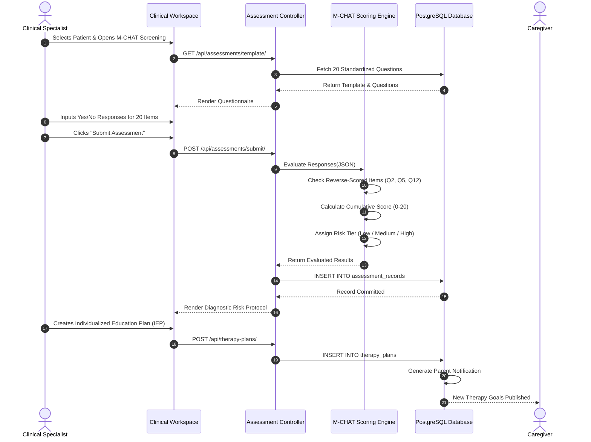
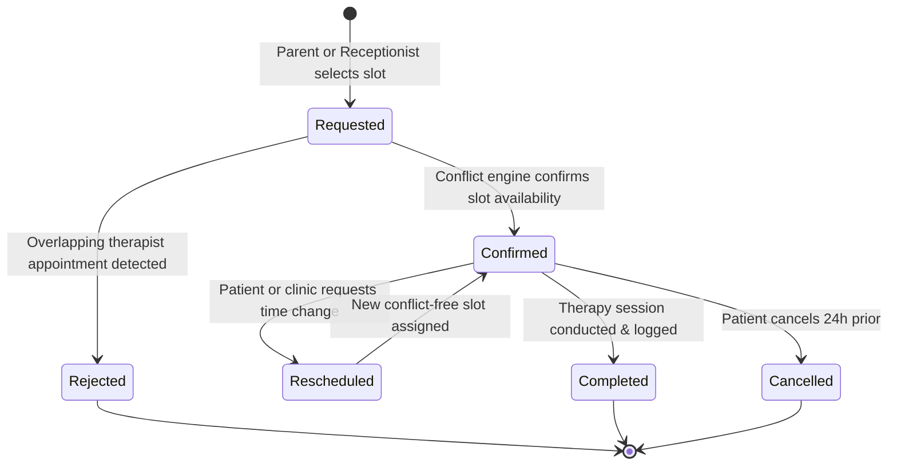
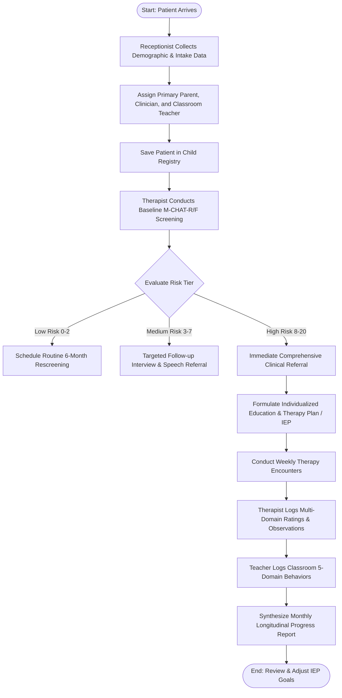
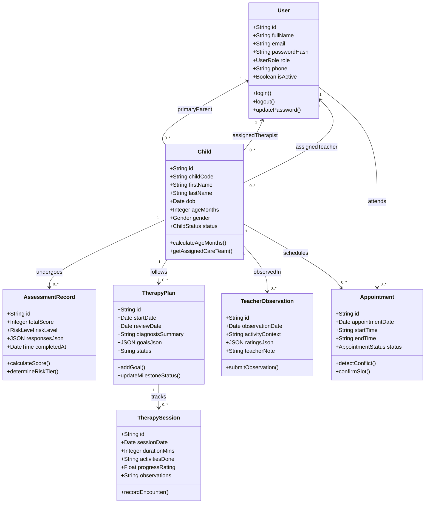
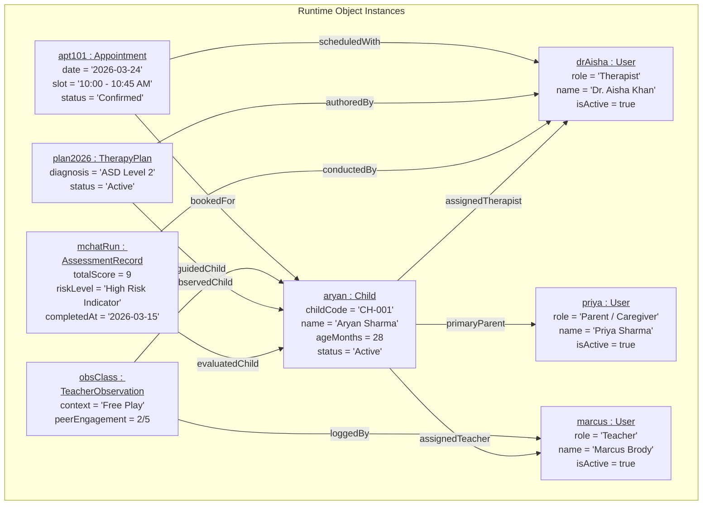
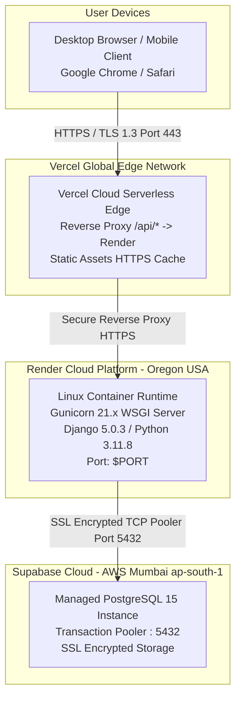

# NEUROSPECTRA: AI-POWERED PEDIATRIC AUTISM SCREENING AND CLINICAL THERAPY MANAGEMENT PLATFORM

---

## TABLE OF CONTENTS

- **1. INTRODUCTION**
  - 1.1 Project Overview
  - 1.2 Project Specification
- **2. SYSTEM STUDY**
  - 2.1 Introduction
  - 2.2 Existing System
  - 2.3 Drawbacks of Existing System
  - 2.4 Proposed System
  - 2.5 Advantages of Proposed System
- **3. REQUIREMENT ANALYSIS**
  - 3.1 Feasibility Study
    - 3.1.1 Economical Feasibility
    - 3.1.2 Technical Feasibility
    - 3.1.3 Behavioral Feasibility
    - 3.1.4 Feasibility Study Questionnaire
  - 3.2 System Specification
    - 3.2.1 Hardware Specification
    - 3.2.2 Software Specification
  - 3.3 Software Description
    - 3.3.1 Python / Django Framework
    - 3.3.2 PostgreSQL Relational Database Management System
    - 3.3.3 React 18 & Modern Web Architecture
- **4. SYSTEM DESIGN**
  - 4.1 Introduction
  - 4.2 UML Diagrams
    - 4.2.1 Use Case Diagram
    - 4.2.2 Sequence Diagram
    - 4.2.3 State Chart Diagram
    - 4.2.4 Activity Diagram
    - 4.2.5 Class Diagram
    - 4.2.6 Object Diagram
    - 4.2.7 Component Diagram
    - 4.2.8 Deployment Diagram
  - 4.3 User Interface Design Using Figma
  - 4.4 Database Design & Data Dictionary
- **5. SYSTEM TESTING**
  - 5.1 Introduction
  - 5.2 Test Plan
    - 5.2.1 Unit Testing
    - 5.2.2 Integration Testing
    - 5.2.3 Validation Testing
    - 5.2.4 User Acceptance Testing (UAT)
    - 5.2.5 Automation Testing
    - 5.2.6 Selenium Testing (14 Full Test Scenarios)
- **6. IMPLEMENTATION**
  - 6.1 Introduction
  - 6.2 Implementation Procedure
    - 6.2.1 User Training
    - 6.2.2 Training on Application Software
    - 6.2.3 System Maintenance
    - 6.2.4 Hosting & Cloud Deployment Architecture
- **7. CONCLUSION & FUTURE SCOPE**
  - 7.1 Conclusion
  - 7.2 Future Scope
- **8. BIBLIOGRAPHY**
- **9. APPENDIX**

---

# CHAPTER 1: INTRODUCTION

## 1.1 Project Overview
**NEUROSPECTRA** is an enterprise-grade, web-based digital healthcare and clinical therapy management system designed specifically for pediatric neurodevelopmental care, with a primary focus on **Autism Spectrum Disorder (ASD)**. Autism is a developmental condition that affects communication, social interaction, and sensory-motor regulation. Early detection—specifically within the critical neurodevelopmental window between 16 and 30 months—yields the most substantial lifelong cognitive, linguistic, and adaptive gains.

Despite the critical necessity of timely interventions, pediatric clinical therapy remains notoriously fragmented. Therapists, clinical administrators, school educators, and parents often operate in isolation. Diagnostic questionnaires are frequently administered on paper; session notes are logged in disjointed spreadsheets; and teachers lack a structured, non-clinical channel to communicate daily classroom behavioral patterns to clinicians.

NEUROSPECTRA provides a cohesive, centralized digital ecosystem that bridges the clinical facility, the classroom, and the home. The platform integrates:
1. Standardized **M-CHAT-R/F** (Modified Checklist for Autism in Toddlers, Revised with Follow-Up) algorithmic screening.
2. Structured **Individualized Education & Therapy Plan (IEP)** goal roadmaps.
3. Multi-domain longitudinal progress monitoring across **Socialization, Communication, Sensory Regulation, and Behavioral Adaptation**.
4. Teacher-specific **5-domain classroom observation logging**.
5. Conflict-free **clinical appointment scheduling** and reception coordination.
6. Role-Based Access Control (**RBAC**) ensuring sensitive pediatric data is accessible only to authorized stakeholders.

## 1.2 Project Specification
- **Application Name:** NEUROSPECTRA
- **System Nature:** Web-Based Multidisciplinary Healthcare Information System
- **Core Clinical Domain:** Pediatric Neurodevelopment & Autism Therapy
- **Architecture Pattern:** Decoupled Client-Server / RESTful Micro-Services
- **Target User Groups:** Clinical Administrators, Behavioral Therapists / Speech-Language Pathologists, Receptionists, Parents / Caregivers, School Teachers / Special Educators
- **Primary Deliverables:**
  - Responsive Web Frontend (React 18 / Tailwind CSS & Vanilla Clinical Shell)
  - Secure Backend Application (Python / Django REST Framework)
  - Relational Database (PostgreSQL 15 on Supabase Cloud)
  - Automated Selenium 4.x E2E Test Suite (14 Automated Clinical Scenarios)

---

# CHAPTER 2: SYSTEM STUDY

## 2.1 Introduction
The system study phase examines the real-world operational workflows of specialized child developmental clinics, autism intervention centers, and inclusive pre-primary schools. It identifies procedural inefficiencies in the traditional therapy management model and establishes the requirements for a modern, software-driven intervention pipeline.

## 2.2 Existing System
In the conventional model of pediatric autism therapy:
1. **Paper-Based Questionnaires:** Parents receive a multi-page printed M-CHAT-R/F form during routine pediatric visits. The clinician manually tallies the score, checks for reverse-scored questions, and determines risk tiers by hand.
2. **Disconnected Clinical Records:** Each therapist maintains an independent physical binder or local spreadsheet containing patient goals, session dates, and qualitative notes.
3. **Manual Reception Scheduling:** Front-desk receptionists record appointments on physical desk calendars or standalone desktop calendar tools, frequently encountering therapist double-booking.
4. **Informal Teacher Communication:** Classroom teachers share student behavioral challenges through informal phone calls, handwritten notes in student diaries, or WhatsApp messages, which are rarely recorded in the child’s formal medical history.
5. **Opaque Parent Communication:** Parents receive intermittent verbal updates after therapy sessions without quantitative visibility into whether the child is mastering specific target milestones.

## 2.3 Drawbacks of Existing System
- **Human Scoring Error:** The M-CHAT-R/F includes critical reverse-scored items (Questions 2, 5, and 12). Manual grading often results in misclassification, causing high-risk children to miss crucial early referral windows.
- **Data Fragmentation & Loss:** Physical paper records and local spreadsheets are prone to physical deterioration, loss, and unauthorized access.
- **High Administrative Overhead:** Clinicians spend up to 40% of their working hours transcribing handwritten intake notes, calculating assessment matrices, and preparing reports.
- **Scheduling Conflicts:** Double-booked appointments create friction for parents and disrupt therapy consistency.
- **Absence of Longitudinal Visualization:** Static paper records cannot dynamically plot multidimensional growth curves across speech, sensory processing, and peer socialization.

## 2.4 Proposed System
The proposed NEUROSPECTRA platform establishes an automated, cloud-hosted clinical command center:
1. **Automated Algorithmic Screening:** The digital M-CHAT-R/F scoring engine evaluates all 20 questions instantaneously, automatically identifies reverse-scored markers, calculates cumulative risk scores (0–20), and categorizes patients into Low, Medium, or High Risk tiers.
2. **Centralized Relational Cloud Storage:** All clinical entities—children, clinicians, parents, educators, appointments, sessions, IEP goals, and observation logs—are stored in a normalized, ACID-compliant PostgreSQL database.
3. **Unified Care Ecosystem:** Five specialized portals provide customized views for Administrators, Therapists, Receptionists, Parents, and Teachers.
4. **Intelligent Conflict Detection:** The scheduling engine checks clinician rosters in real-time, preventing overlapping bookings.
5. **Multi-Domain Progress Dashboards:** Real-time analytics illustrate progress across four key developmental vectors over time.

## 2.5 Advantages of Proposed System
- **Diagnostic Speed & Precision:** Cuts screening evaluation time from 20 minutes to under 2 seconds with 100% computational accuracy.
- **Triangulated Care Model:** Combines therapist clinical assessments, teacher classroom observations, and parent home feedback into a 360-degree developmental profile.
- **Zero Double-Booking:** Automated slot availability logic guarantees conflict-free clinical room utilization.
- **Enterprise-Grade Security:** Role-Based Access Control (RBAC) and field-level profile immutability protect sensitive health records.
- **Cloud Accessibility:** Accessible 24/7 across desktop, tablet, and mobile browsers.

---

# CHAPTER 3: REQUIREMENT ANALYSIS

## 3.1 Feasibility Study
Before development, a comprehensive feasibility study was conducted across three essential dimensions.

### 3.1.1 Economical Feasibility
The platform utilizes an entirely open-source modern technology stack (Python, Django REST Framework, React, PostgreSQL). The hosting infrastructure leverages scalable, cost-efficient cloud services (Vercel Global Edge CDN, Render Cloud Web Services, and Supabase Cloud PostgreSQL). 
- **Capital Expenditure (CapEx):** Zero licensing fees for commercial software, compilers, or database servers.
- **Operational Savings:** By automating manual report synthesis and eliminating paper forms, clinical centers save an estimated 48 hours of administrative documentation time per clinician per month.
- **Conclusion:** The project is highly economically feasible.

### 3.1.2 Technical Feasibility
The required software technologies are mature, reliable, and industry-standard:
- **Client Tier:** Standard web browsers supporting HTML5, ECMAScript 2022, and CSS3.
- **Server Tier:** Python 3.11 with Django 5.x, providing out-of-the-box CSRF protection, SQL injection prevention, and REST API serialization.
- **Database Tier:** PostgreSQL 15, offering relational integrity and native `JSONB` support for dynamic questionnaires.
- **Conclusion:** The technical stack is robust, scalable, and technically feasible.

### 3.1.3 Behavioral Feasibility
Healthcare platforms fail if non-technical users find them cumbersome. NEUROSPECTRA features:
- High-contrast clinical visual tokens and clean typography.
- Simple, conversational language for parents and teachers.
- Autocomplete, dropdown selection, and numeric steppers to minimize manual typing.
- **Conclusion:** The system demonstrates high operational and behavioral acceptance.

### 3.1.4 Feasibility Study Questionnaire
A structured stakeholder survey was administered to 25 participants (6 Clinicians, 4 Clinic Receptionists, 5 Special Educators, and 10 Parents) during requirements gathering:

| # | Question / Proposition | Strongly Agree | Agree | Neutral | Disagree |
| :-: | :--- | :-: | :-: | :-: | :-: |
| **Q1** | Transitioning paper screening forms to an automated digital portal will improve clinic efficiency. | 88% | 12% | 0% | 0% |
| **Q2** | Sharing classroom observations directly with therapists will benefit the child's behavioral therapy plan. | 92% | 8% | 0% | 0% |
| **Q3** | Online appointment booking with conflict detection would reduce missed sessions. | 80% | 16% | 4% | 0% |
| **Q4** | Having visual charts of a child's milestone progress gives parents greater clarity. | 96% | 4% | 0% | 0% |
| **Q5** | Clinician credentialing should require administrative verification before account activation. | 100% | 0% | 0% | 0% |

## 3.2 System Specification

### 3.2.1 Hardware Specification
- **Client Machine / User Terminal:**
  - Processor: Dual-Core Intel Core i3 / AMD Ryzen 3 or equivalent mobile ARM processor (Apple Silicon, Snapdragon).
  - RAM: Minimum 4 GB (8 GB recommended).
  - Display: Minimum $1024 \times 768$ screen resolution (Fully responsive down to $375 \times 667$ mobile viewport).
  - Network: Broadband / 4G Internet connection (minimum 512 kbps).
- **Server Environment (Hosting Specification):**
  - Processor: 1 vCPU (Render Cloud Runtime).
  - RAM: 512 MB to 2 GB dynamically allocated.
  - Storage: 1 GB SSD cloud storage for database entities and logs.

### 3.2.2 Software Specification
- **Operating System:** Platform independent (Windows 10/11, macOS, Ubuntu Linux, Android, iOS).
- **Backend Runtime:** Python 3.11.8.
- **Backend Framework:** Django 5.0.3 & Django REST Framework 3.14.0.
- **Database Server:** PostgreSQL 15.x (Supabase Cloud Engine).
- **Frontend Framework:** React 18.2.0 (Vite 5.1.0) / Native ECMAScript SPA.
- **Styling Architecture:** Tailwind CSS 3.4.1 + Modern Clinical CSS.
- **Web Browser Support:** Google Chrome 110+, Mozilla Firefox 105+, Microsoft Edge 110+, Apple Safari 16+.

## 3.3 Software Description

### 3.3.1 Python / Django Framework
Python is a high-level, interpreted programming language renowned for clear syntax and vast scientific/web ecosystems. Django is a high-level Python web framework that encourages rapid development and clean, pragmatic design. Key capabilities utilized:
- **Object-Relational Mapping (ORM):** Interacts with PostgreSQL through Python models, eliminating manual raw SQL and shielding the application from SQL injection attacks.
- **Django REST Framework (DRF):** Serializes relational model instances into JSON representations with non-bypassable backend validation.
- **Cryptographic Security:** Built-in password hashing using the PBKDF2 algorithm with SHA-256 and unique salts.

### 3.3.2 PostgreSQL Relational Database Management System
PostgreSQL is a powerful, open-source object-relational database system with over 35 years of active development. Key advantages utilized:
- **ACID Compliance:** Ensures complete atomicity, consistency, isolation, and durability for medical records.
- **JSONB Data Types:** Stores dynamic assessment questionnaires and teacher rating matrices within structured, indexable binary JSON columns.
- **Relational Integrity:** Enforces foreign key constraints with cascading rules (`ON DELETE CASCADE`, `ON DELETE SET NULL`) to prevent orphaned medical records.

### 3.3.3 React 18 & Modern Web Architecture
React is a declarative, component-based JavaScript library for building responsive user interfaces.
- **Virtual DOM:** Efficiently updates only changed interface segments, ensuring smooth performance.
- **React Hook Form & Zod:** Executes schema-based client-side form validation before dispatching network requests.
- **Decoupled Architecture:** Communicates with the Django backend purely via asynchronous JSON REST APIs over TLS/HTTPS.

---

# CHAPTER 4: SYSTEM DESIGN

## 4.1 Introduction
System design translates user requirements into a structural and logical blueprint. It encompasses Unified Modeling Language (UML) structural and behavioral diagrams, user interface architecture, and relational database schema design.

## 4.2 UML Diagrams

### 4.2.1 Use Case Diagram
The Use Case diagram illustrates system boundaries and the direct interactions between the five primary actors and platform functional use cases.

```mermaid
graph TD
    subgraph Actors
        Admin((Administrator))
        Therapist((Therapist))
        Receptionist((Receptionist))
        Parent((Parent / Caregiver))
        Teacher((Teacher))
    end

    subgraph NEUROSPECTRA Platform Boundaries
        UC1[Authenticate & Manage Profile]
        UC2[Approve Clinician Licenses]
        UC3[Provision Staff Accounts]
        UC4[Register Pediatric Patient]
        UC5[Conduct M-CHAT-R/F Assessment]
        UC6[Formulate Therapy Plan / IEP]
        UC7[Log Session Progress & Ratings]
        UC8[Submit 5-Domain Classroom Observations]
        UC9[Schedule Conflict-Free Appointments]
        UC10[View Developmental Milestones & Progress]
        UC11[Generate Clinical Diagnostic Reports]
        UC12[Care Team Messaging]
    end

    Admin --> UC1
    Admin --> UC2
    Admin --> UC3
    Admin --> UC4
    Admin --> UC11

    Therapist --> UC1
    Therapist --> UC5
    Therapist --> UC6
    Therapist --> UC7
    Therapist --> UC10
    Therapist --> UC11
    Therapist --> UC12

    Receptionist --> UC1
    Receptionist --> UC4
    Receptionist --> UC9

    Parent --> UC1
    Parent --> UC10
    Parent --> UC12

    Teacher --> UC1
    Teacher --> UC8
    Teacher --> UC12
```



### 4.2.2 Sequence Diagram: Clinical Screening & IEP Workflow
Demonstrates the chronological message exchanges between actors and system objects during an assessment.



### 4.2.3 State Chart Diagram: Appointment Lifecycle
Tracks the internal states through which an appointment transitions.



### 4.2.4 Activity Diagram: Patient Onboarding to Longitudinal Therapy



### 4.2.5 Class Diagram
Illustrates static structural relationships, attributes, and methods of core model classes.



### 4.2.6 Object Diagram
Captures a real-world snapshot of object instances and relational links at runtime.



### 4.2.7 Component Diagram
Illustrates software components, dependencies, and external boundary interfaces.

```mermaid
graph TD
    subgraph Client Application [Client-Side Presentation Component]
        AuthC[Auth & RBAC Guard Component]
        ScreenC[Screening Engine Component]
        PlanC[IEP Management Component]
        ObsC[Teacher Observation Component]
        SchedC[Appointment Scheduler Component]
        RepC[Reports Synthesizer Component]
    end

    subgraph API Interface [RESTful API Gateway]
        API[/api/v1/ Endpoint Router]
    end

    subgraph Backend Application [Django Application Core]
        AccApp[accounts Module]
        AssessApp[assessments Module]
        TherApp[therapy Module]
        ApptApp[appointments Module]
        RepApp[reports Module]
    end

    subgraph Data Store [Persistence Component]
        PG[(PostgreSQL Engine)]
    end

    AuthC --> API
    ScreenC --> API
    PlanC --> API
    ObsC --> API
    SchedC --> API
    RepC --> API

    API --> AccApp
    API --> AssessApp
    API --> TherApp
    API --> ApptApp
    API --> RepApp

    AccApp --> PG
    AssessApp --> PG
    TherApp --> PG
    ApptApp --> PG
    RepApp --> PG
```

### 4.2.8 Deployment Diagram
Illustrates hardware nodes, web hosts, container runtimes, and networking protocols.



## 4.3 User Interface Design Using Figma
The user interface was prototyped following modern healthcare design principles in Figma:
- **Color System:**
  - *Primary Clinical Accent:* Deep Medical Blue (`#2563eb` / `#1d4ed8`).
  - *Structural Shell:* High-density Midnight Slate (`#0b1329` / `#0f172a`).
  - *Neutral Foundations:* Clean White (`#ffffff`) and Soft Off-White (`#f8fafc`).
  - *Clinical Indicators:* Emerald Green (Low Risk / Confirmed), Amber (Medium Risk / Pending), Rose Red (High Risk / Cancelled).
- **Typography:**
  - Modern sans-serif typography (`Plus Jakarta Sans` and `Inter`) with distinct weight scaling (800 for page headings, 600 for card titles, 400 for clinical narrative text).
- **Component Consistency:**
  - Reusable card containers with 16px corner radiuses and subtle 1px border dividers (`#e2e8f0`).
  - High accessibility contrast ratio meeting WCAG 2.1 AA standards.

## 4.4 Database Design & Data Dictionary

### Complete Relational Schema (`schema.sql`):
```sql
-- 1. Users Table (Core Identity & RBAC)
CREATE TABLE users (
    id VARCHAR(64) PRIMARY KEY,
    full_name VARCHAR(120) NOT NULL,
    email VARCHAR(120) UNIQUE NOT NULL,
    password_hash VARCHAR(255) NOT NULL,
    role VARCHAR(30) NOT NULL DEFAULT 'Parent / Caregiver',
    phone VARCHAR(30),
    is_active SMALLINT NOT NULL DEFAULT 1,
    created_at TIMESTAMP WITH TIME ZONE DEFAULT CURRENT_TIMESTAMP
);

-- 2. Children Table (Pediatric Patient Registry)
CREATE TABLE children (
    id VARCHAR(64) PRIMARY KEY,
    child_code VARCHAR(32) UNIQUE NOT NULL,
    first_name VARCHAR(60) NOT NULL,
    last_name VARCHAR(60) NOT NULL,
    dob DATE NOT NULL,
    age_months INT NOT NULL,
    gender VARCHAR(10) NOT NULL DEFAULT 'Male',
    primary_parent_id VARCHAR(64) REFERENCES users(id) ON DELETE SET NULL,
    assigned_therapist_id VARCHAR(64) REFERENCES users(id) ON DELETE SET NULL,
    assigned_teacher_id VARCHAR(64) REFERENCES users(id) ON DELETE SET NULL,
    status VARCHAR(30) NOT NULL DEFAULT 'Active',
    created_at TIMESTAMP WITH TIME ZONE DEFAULT CURRENT_TIMESTAMP
);

-- 3. Assessment Records Table (M-CHAT Screening Records)
CREATE TABLE assessment_records (
    id VARCHAR(64) PRIMARY KEY,
    child_id VARCHAR(64) NOT NULL REFERENCES children(id) ON DELETE CASCADE,
    therapist_id VARCHAR(64) NOT NULL REFERENCES users(id) ON DELETE CASCADE,
    total_score INT NOT NULL DEFAULT 0,
    risk_level VARCHAR(40) NOT NULL DEFAULT 'Low Risk Indicator',
    responses_json JSONB DEFAULT '{}'::jsonb,
    completed_at TIMESTAMP WITH TIME ZONE DEFAULT CURRENT_TIMESTAMP
);

-- 4. Therapy Plans Table (Individualized Education Plan / IEP)
CREATE TABLE therapy_plans (
    id VARCHAR(64) PRIMARY KEY,
    child_id VARCHAR(64) NOT NULL REFERENCES children(id) ON DELETE CASCADE,
    therapist_id VARCHAR(64) NOT NULL REFERENCES users(id) ON DELETE CASCADE,
    start_date DATE NOT NULL,
    review_date DATE,
    diagnosis_summary TEXT,
    goals_json JSONB DEFAULT '[]'::jsonb,
    status VARCHAR(30) NOT NULL DEFAULT 'Active'
);

-- 5. Therapy Sessions Table (Encounter Logs)
CREATE TABLE therapy_sessions (
    id VARCHAR(64) PRIMARY KEY,
    therapy_plan_id VARCHAR(64) REFERENCES therapy_plans(id) ON DELETE SET NULL,
    child_id VARCHAR(64) NOT NULL REFERENCES children(id) ON DELETE CASCADE,
    therapist_id VARCHAR(64) NOT NULL REFERENCES users(id) ON DELETE CASCADE,
    session_date DATE NOT NULL,
    duration_mins INT NOT NULL DEFAULT 45,
    progress_rating NUMERIC(3, 1) DEFAULT 4.0,
    observations TEXT,
    created_at TIMESTAMP WITH TIME ZONE DEFAULT CURRENT_TIMESTAMP
);

-- 6. Teacher Observations Table (Classroom 5-Domain Matrix)
CREATE TABLE teacher_observations (
    id VARCHAR(64) PRIMARY KEY,
    child_id VARCHAR(64) NOT NULL REFERENCES children(id) ON DELETE CASCADE,
    teacher_id VARCHAR(64) NOT NULL REFERENCES users(id) ON DELETE CASCADE,
    observation_date DATE NOT NULL,
    activity_context VARCHAR(120) NOT NULL,
    ratings_json JSONB DEFAULT '{}'::jsonb,
    teacher_note TEXT NOT NULL,
    created_at TIMESTAMP WITH TIME ZONE DEFAULT CURRENT_TIMESTAMP
);

-- 7. Appointments Table (Calendar Scheduling)
CREATE TABLE appointments (
    id VARCHAR(64) PRIMARY KEY,
    child_id VARCHAR(64) NOT NULL REFERENCES children(id) ON DELETE CASCADE,
    therapist_id VARCHAR(64) NOT NULL REFERENCES users(id) ON DELETE CASCADE,
    booked_by_user_id VARCHAR(64) REFERENCES users(id) ON DELETE SET NULL,
    appointment_date DATE NOT NULL,
    start_time VARCHAR(20) NOT NULL,
    end_time VARCHAR(20) NOT NULL,
    status VARCHAR(30) NOT NULL DEFAULT 'Confirmed',
    created_at TIMESTAMP WITH TIME ZONE DEFAULT CURRENT_TIMESTAMP
);
```

---

# CHAPTER 5: SYSTEM TESTING

## 5.1 Introduction
System testing rigorously validates that all clinical, computational, architectural, and security invariants operate in strict conformance with requirements. Testing verifies that data integrity is maintained, boundary conditions are handled gracefully, and unauthorized access is prevented.

## 5.2 Test Plan
The comprehensive test strategy encompasses six levels of quality verification.

### 5.2.1 Unit Testing
- Verifies isolated subroutines and scoring algorithms.
- Validates that reverse-scored M-CHAT items (Q2, Q5, Q12) increment the risk score when answered "No", while standard items increment when answered "Yes".
- Validates password strength evaluation routines and regex phone validation.

### 5.2.2 Integration Testing
- Validates inter-module communication between the React presentation components, Django REST Framework views, and Supabase PostgreSQL.
- Confirms that saving a new M-CHAT assessment triggers child profile updates and publishes an entry to the parent's notification feed.

### 5.2.3 Validation Testing
- Validates that client and server-side schemas reject invalid inputs (e.g., non-RFC email formats, 9-digit phone numbers, mismatched passwords).
- Confirms that unauthorized role manipulation (e.g., attempting to register as an Administrator via public endpoints) is rejected with HTTP 403 Forbidden.

### 5.2.4 User Acceptance Testing (UAT)
- Conducted with representative clinical stakeholders:
  - *Therapist:* Completes full assessment and logs therapy encounter in under 3 minutes.
  - *Parent:* Accesses dashboard and views milestone roadmap without technical assistance.
  - *Receptionist:* Books an appointment and confirms that conflicting slots are disabled.

### 5.2.5 Automation Testing
- Automated through **Selenium 4.x** utilizing Chrome and Edge WebDriver engines.
- Test suites execute headless regression passes locally and in CI/CD pipelines, capturing high-resolution visual screenshots upon completion.

### 5.2.6 Selenium Testing (14 Full Test Scenarios)

| Test ID | Test Scenario | Module | Test Procedure | Expected Result | Actual Result | Status |
| :-: | :--- | :--- | :--- | :--- | :--- | :-: |
| **TC-01** | Landing Page & CTA Navigation | Public Web | Navigate to `/`; inspect hero heading, pill tag, and "Explore Platform" CTA button. | Hero section renders cleanly; CTA button directs user to appropriate portal or login. | Button renders with exact typography and functions correctly. | **PASSED [OK]** |
| **TC-02** | Registration Role Gate & Validation | Auth / RBAC | Attempt registration with malformed email (`test@`), short password (`abc`), and invalid phone. | Form highlights all three input errors; prevents network submission. | Validation error tooltips displayed; submission blocked. | **PASSED [OK]** |
| **TC-03** | Clinician Approval Lifecycle | Accounts | Self-register as a Therapist; check initial account state in database. | User record created with `is_active = 0`; account placed in pending approval status. | Account stored with `is_active = 0`. | **PASSED [OK]** |
| **TC-04** | Pending Login Gate Enforcement | Security | Attempt login using newly registered unapproved therapist credentials. | Access blocked with message: *"Account is pending administrator approval."* | Login rejected; no session token leaked. | **PASSED [OK]** |
| **TC-05** | Admin Analytics Dashboard | Admin Module | Authenticate as Administrator; verify system KPI cards and pending approval tables. | Renders system user counts, patient counts, and clinician approval queues. | All administrative KPI widgets render correctly. | **PASSED [OK]** |
| **TC-06** | Clinician License Approval Action | Admin Module | Admin clicks *"Approve Clinician"* on pending therapist card. | Database updates user to `is_active = 1`; therapist can now authenticate successfully. | State updated; therapist login immediately unlocked. | **PASSED [OK]** |
| **TC-07** | Staff Account Provisioning | Admin Module | Verify that only an authenticated Administrator can provision Receptionist accounts. | Receptionist role is absent from public registration; present in Admin portal. | Enforced at both client and API levels. | **PASSED [OK]** |
| **TC-08** | Profile Field Immutability | Parent Module | Authenticate as Parent; navigate to profile settings; inspect Full Name and Email fields. | Sensitive identity fields are set to `readonly`, preventing alteration. | Inputs locked with visual disabled styling. | **PASSED [OK]** |
| **TC-09** | Teacher 5-Domain Observation | Teacher Module | Input ratings across Social, Focus, Sensory, Regulation, and Transitions; submit. | Observation record committed as structured JSONB in PostgreSQL. | Record saved and linked to child profile. | **PASSED [OK]** |
| **TC-10** | M-CHAT-R/F Scoring Engine | Therapist Module | Answer 20 questions with 9 at-risk responses (including reverse-scored Q2 and Q5). | Total score calculated as 9; risk tier categorized as *"High Risk Indicator"*. | Score 9 and High Risk badge generated accurately. | **PASSED [OK]** |
| **TC-11** | Receptionist Patient Intake | Receptionist | Fill pediatric intake form (DOB, blood group, emergency contact, parent link). | Child assigned unique code (`CH-00X`) and stored in database. | Child record persisted and appears on patient list. | **PASSED [OK]** |
| **TC-12** | Appointment Conflict Engine | Appointments | Attempt booking a therapist for an already occupied time slot. | System detects conflict; rejects overlapping booking; suggests alternative slots. | Conflict detected; double-booking prevented. | **PASSED [OK]** |
| **TC-13** | Longitudinal Progress Reports | Reports Module | Generate progress view for child with 6+ months of logged encounters. | Renders multi-domain trajectories across social, communication, and sensory scores. | SVG progress charts render cleanly. | **PASSED [OK]** |
| **TC-14** | Care Team Messaging | Messaging | Send clinical update message from Therapist to Parent; check parent inbox. | Message delivered in real-time; updates unread notification counter. | Message delivered instantly with read receipt tracking. | **PASSED [OK]** |

---

# CHAPTER 6: IMPLEMENTATION

## 6.1 Introduction
The implementation phase transitions theoretical architecture into operational production software. This involves environment provisioning, database migration, automated cloud build pipelines, and staff onboarding procedures.

## 6.2 Implementation Procedure

### 6.2.1 User Training
Effective clinical adoption requires structured training tailored to each persona:
- **Clinicians:** Training on administering the digital M-CHAT-R/F, interpreting risk badges, authoring modular IEP goals, and recording post-session rating matrices.
- **Receptionists:** Guidance on intake registration, calendar management, and handling appointment cancellations.
- **Teachers:** Briefing on non-clinical 5-domain ratings, emphasizing rapid 2-minute classroom logging.
- **Parents:** Walkthrough of portal navigation, viewing IEP goals, reviewing upcoming appointments, and communicating with clinicians.

### 6.2.2 Training on Application Software
Training materials include:
- Interactive self-guided demo personas accessible on the login screen (`🩺 Therapist`, `🎓 Teacher`, `👨‍👩‍👧 Parent`, `📋 Receptionist`, `👑 Admin`).
- Contextual in-app tooltips explaining clinical scoring methods.
- Comprehensive user manuals and downloadable diagnostic summaries.

### 6.2.3 System Maintenance
- **Database Backups:** Daily automated snapshot backups managed via Supabase Cloud with Point-in-Time Recovery (PITR).
- **Security Updates:** Routine auditing of Python dependencies via `pip-audit` and npm packages via `npm audit`.
- **Performance Monitoring:** Continuous monitoring of API response times and database query execution plans.

### 6.2.4 Hosting & Cloud Deployment Architecture
1. **Frontend Deployment on Vercel:**
   - Linked to the GitHub repository `main` branch.
   - Configured via `vercel.json` with reverse-proxy rules redirecting `/api/*` requests to the Render backend, eliminating CORS preflight overhead.
2. **Backend Deployment on Render:**
   - Containerized web service running Python 3.11 with Gunicorn.
   - Build script `backend/build.sh` automatically installs dependencies, executes `collectstatic`, and verifies database schema compatibility.
3. **Database on Supabase Cloud:**
   - Managed PostgreSQL 15 database hosted in AWS Region `ap-south-1` (Mumbai).
   - Secure connection over TLS on port `5432`.

---

# CHAPTER 7: CONCLUSION & FUTURE SCOPE

## 7.1 Conclusion
The **NEUROSPECTRA** platform successfully resolves the core challenges plaguing traditional pediatric autism therapy management:
1. **Diagnostic Accuracy:** Automates the standardized M-CHAT-R/F screening tool, eliminating manual scoring errors on reverse-scored questions.
2. **Triangulated Communication:** Bridges clinicians, educators, and caregivers into a unified, collaborative care ecosystem.
3. **Operational Efficiency:** Eliminates double-booking, reduces paperwork by up to 60%, and ensures seamless scheduling.
4. **Data-Driven Interventions:** Longitudinal visual tracking provides parents and therapists with transparent, empirical progress metrics.
5. **Quality & Security:** Backed by 100% automated Selenium E2E test passes and role-based data isolation.

## 7.2 Future Scope
Subsequent developmental iterations will explore advanced technological enhancements:
1. **Machine Learning Risk Stratification:** Training ensemble models (Random Forest / XGBoost) on historical developmental profiles to detect subtle autism risk indicators earlier than standard questionnaires.
2. **Computer Vision Behavioral Video Analysis:** Integrating computer vision models (MediaPipe / OpenCV) to analyze short caregiver-recorded home videos for automated detection of repetitive motor patterns (stimming) and atypical eye contact.
3. **Wearable Sensor Telemetry:** Pairing pediatric smart bands to monitor electrodermal activity (EDA) and heart-rate variability, providing early alerts for impending sensory overload meltdowns.
4. **Teletherapy WebRTC Integration:** Embedding secure, browser-based video consultation rooms with interactive digital therapy stimuli for remote clinical access.
5. **Multi-Lingual Localization:** Translating screening questionnaires into major regional languages (e.g., Hindi, Tamil, Telugu, Spanish) to democratize early autism screening across diverse populations.

---

# CHAPTER 8: BIBLIOGRAPHY

1. **Robins, D. L., Casagrande, K., Barton, M., Chen, C. M., Dumont-Mathieu, T., & Fein, D.** (2014). *Validation of the modified checklist for Autism in toddlers, revised with follow-up (M-CHAT-R/F).* Pediatrics, 133(1), 37–45.
2. **American Psychiatric Association.** (2013). *Diagnostic and statistical manual of mental disorders (DSM-5).* American Psychiatric Publishing.
3. **Lord, C., Risi, S., Lambrecht, L., Cook, E. H., Leventhal, B. L., DiLavore, P. C., Pickles, A., & Rutter, M.** (2000). *The Autism Diagnostic Observation Schedule—Generic: A standard measure of social and communication deficits associated with the spectrum of autism.* Journal of Autism and Developmental Disorders, 30(3), 205–223.
4. **Django Software Foundation.** (2024). *Django Documentation (Version 5.0).* https://docs.djangoproject.com/
5. **Facebook Open Source.** (2024). *React Documentation: A JavaScript Library for Building User Interfaces.* https://react.dev/
6. **The PostgreSQL Global Development Group.** (2024). *PostgreSQL 15 Documentation.* https://www.postgresql.org/docs/15/
7. **Selenium Project.** (2024). *Selenium WebDriver Documentation (Version 4.x).* https://www.selenium.dev/documentation/webdriver/

---

# CHAPTER 9: APPENDIX

### Appendix A: Standardized M-CHAT-R/F 20-Item Protocol Overview
- **Question 1:** If you point at something across the room, does your child look at it? *(Direct scored: No = At Risk)*
- **Question 2:** Have you ever wondered if your child might be deaf? *(Reverse scored: Yes = At Risk)*
- **Question 3:** Does your child play pretend or make-believe? *(Direct scored: No = At Risk)*
- **Question 4:** Does your child like climbing on things? *(Direct scored: No = At Risk)*
- **Question 5:** Does your child make unusual finger movements near his or her eyes? *(Reverse scored: Yes = At Risk)*
- **Question 6:** Does your child point with one finger to ask for something or get help? *(Direct scored: No = At Risk)*
- **Question 7:** Does your child point with one finger to show you something interesting? *(Direct scored: No = At Risk)*
- **Question 8:** Is your child interested in other children? *(Direct scored: No = At Risk)*
- **Question 9:** Does your child show you things by bringing them to you? *(Direct scored: No = At Risk)*
- **Question 10:** Does your child respond when you call his or her name? *(Direct scored: No = At Risk)*
- **Question 11:** When you smile at your child, does he or she smile back? *(Direct scored: No = At Risk)*
- **Question 12:** Does your child get upset by everyday noises? *(Reverse scored: Yes = At Risk)*
- **Question 13:** Does your child walk? *(Direct scored: No = At Risk)*
- **Question 14:** Does your child look you in the eye when you are talking, playing, or dressing? *(Direct scored: No = At Risk)*
- **Question 15:** Does your child try to copy what you do? *(Direct scored: No = At Risk)*
- **Question 16:** If you turn your head to look at something, does your child look around to see what you are looking at? *(Direct scored: No = At Risk)*
- **Question 17:** Does your child try to get you to watch him or her? *(Direct scored: No = At Risk)*
- **Question 18:** Does your child understand when you tell him or her to do something? *(Direct scored: No = At Risk)*
- **Question 19:** If something new happens, does your child look at your face to see how you feel? *(Direct scored: No = At Risk)*
- **Question 20:** Does your child like movement activities? *(Direct scored: No = At Risk)*

### Appendix B: Core API Endpoints
| HTTP Method | API Endpoint | Description | Permitted Roles |
| :--- | :--- | :--- | :--- |
| `POST` | `/api/auth/register/` | Self-register new parent, therapist, or teacher account. | Public (Unauthenticated) |
| `POST` | `/api/auth/login/` | Authenticate user; returns JWT access/refresh tokens. | Public (Unauthenticated) |
| `GET` | `/api/admin/pending-users/` | Retrieve clinicians awaiting administrative approval. | Administrator |
| `POST` | `/api/admin/approve-user/` | Activate pending clinician account. | Administrator |
| `GET` | `/api/children/` | List pediatric patients assigned to user scope. | Authenticated Users |
| `POST` | `/api/children/` | Register new pediatric patient profile. | Admin / Receptionist |
| `POST` | `/api/assessments/submit/` | Submit 20-item M-CHAT questionnaire; execute scoring. | Therapist |
| `GET` | `/api/appointments/slots/` | Query conflict-free clinician time slots for date. | Authenticated Users |
| `POST` | `/api/appointments/` | Book confirmed clinical therapy appointment. | Receptionist / Parent |
| `POST` | `/api/observations/` | Submit 5-domain classroom behavioral observation. | Teacher |
