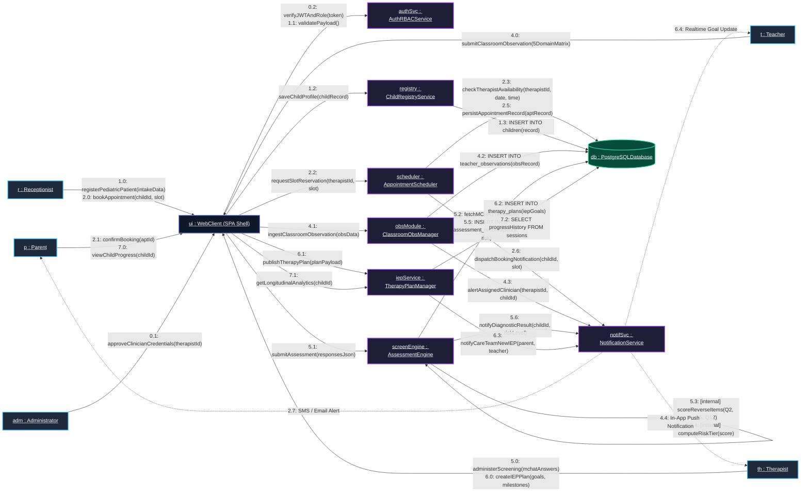
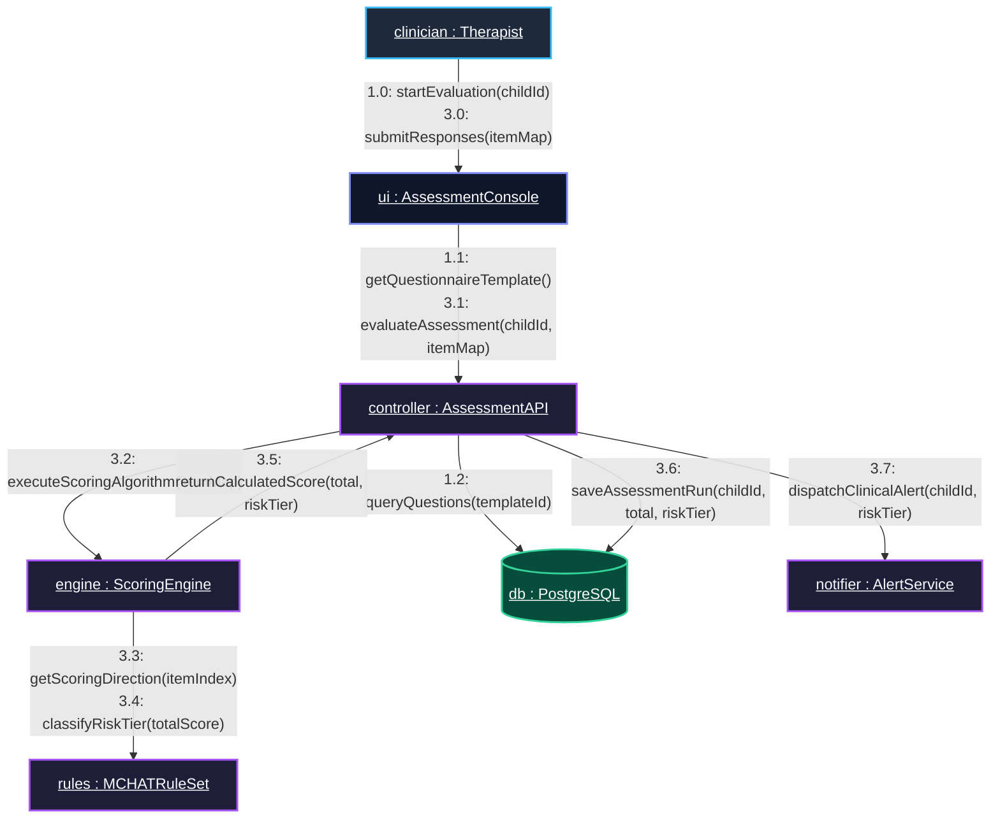
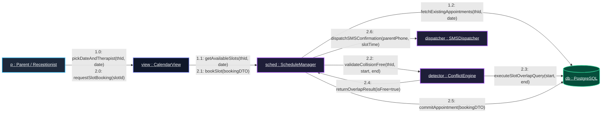
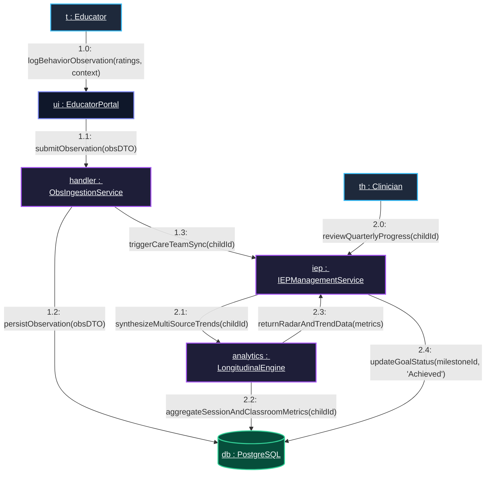

# NEUROSPECTRA — UML Collaboration (Communication) Diagram Specification

**Project Title:** NEUROSPECTRA: AI-Powered Pediatric Autism Spectrum Screening, Clinical Assessment, and Multidisciplinary Therapy Management Platform  
**Document Type:** Software Engineering Architecture Artifact — UML 2.5 Communication / Collaboration Diagram  
**Scope:** Structural Organization, Object Associations, Links, and Chronological Message Passing Across Multidisciplinary Care Actors and Backend Services  
**Target Audience:** Academic Reviewers, Software Architects, Clinical Project Evaluators, and Engineering Teams  

---

## Table of Contents
1. [Overview of UML Collaboration Diagrams](#1-overview-of-uml-collaboration-diagrams)
2. [Collaboration Diagram vs. Sequence Diagram](#2-collaboration-diagram-vs-sequence-diagram)
3. [Master System Collaboration Diagram](#3-master-system-collaboration-diagram)
   - 3.1 Visual Mermaid Communication Diagram
   - 3.2 Formatted Monospace / ASCII Architectural Representation
   - 3.3 Chronological Message Trace Table
4. [Detailed Sub-System Collaboration Diagrams](#4-detailed-sub-system-collaboration-diagrams)
   - 4.1 Sub-Diagram 1: Standardized M-CHAT-R/F Screening & Risk Stratification
   - 4.2 Sub-Diagram 2: Conflict-Free Multi-Clinician Appointment Scheduling
   - 4.3 Sub-Diagram 3: Classroom Observation & Multidisciplinary IEP Feedback Loop
5. [Object Roles and Structural Link Definitions](#5-object-roles-and-structural-link-definitions)
6. [Design Patterns & Architectural Adherence](#6-design-patterns--architectural-adherence)

---

## 1. Overview of UML Collaboration Diagrams

In the **Unified Modeling Language (UML 2.5)**, a **Collaboration Diagram** (formally designated as a **Communication Diagram**) is an interaction diagram that illustrates the structural relationships between cooperating objects and the messages they exchange to accomplish a specific clinical or operational objective.

While a **Sequence Diagram** organizes interactions sequentially along vertical lifelines (emphasizing time order), a **Collaboration Diagram** organizes interactions around the **structural links** connecting objects (emphasizing spatial organization and software architecture).

### Key Elements of NEUROSPECTRA Communication Diagrams:
- **Object Nodes (`objectName : ClassName`):** Distinct software components, controllers, domain models, or external actors participating in the scenario.
- **Structural Links (`—`):** Paths of communication or associations over which messages can be passed.
- **Numbered Messages (`[sequence_number]: [operationName(args)]`):** Directional messages exchanged along structural links. The hierarchical decimal notation (`1.0`, `1.1`, `1.2`, `2.0`, `2.1`) strictly designates nested activation depth and chronological invocation order.
- **Return Flows / Guards (`[condition]`):** Constraints determining whether a branch executes and the data returned upon successful completion.

---

## 2. Collaboration Diagram vs. Sequence Diagram

For academic defense and software engineering reviews, understanding the complementary nature of interaction diagrams is critical:

| Architectural Metric | UML Sequence Diagram | UML Collaboration (Communication) Diagram |
| :--- | :--- | :--- |
| **Primary Focus** | **Time Sequence & Lifelines**: Emphasizes the exact chronological ordering and duration of activations. | **Structural Architecture & Relationships**: Emphasizes the static object links and which objects communicate with one another. |
| **Layout Topology** | Two-dimensional grid: Objects on horizontal axis, time flowing downward on vertical lifelines. | Graph/Network topology: Objects positioned as nodes in space with communication links connecting them. |
| **Message Ordering** | Implicit from top-to-bottom vertical placement. | Explicit via **nested sequence numbers** (e.g., `1.0`, `1.1`, `1.1.1`, `2.0`). |
| **Best Used For** | Detailed timing traces, asynchronous callbacks, and real-time execution bounds. | Understanding component coupling, dependency networks, and impact of refactoring an object’s interface. |
| **NEUROSPECTRA Utility** | Visualizing request-response latency and session timeouts during screening. | Visualizing how the 5 distinct user roles collaborate through centralized controllers and services. |

---

## 3. Master System Collaboration Diagram

The Master Collaboration Diagram illustrates the end-to-end lifecycle of a pediatric patient in NEUROSPECTRA:
1. Patient intake by the Receptionist.
2. Conflict-free appointment booking.
3. Classroom observation by the School Teacher.
4. M-CHAT-R/F diagnostic screening and risk stratification by the Therapist.
5. Formulation of Individualized Education & Therapy Plans (IEP).
6. Longitudinal progress visualization by the Parent.

### 3.1 Visual Mermaid Communication Diagram



---

### 3.2 Formatted Monospace / ASCII Architectural Representation

This ASCII representation is designed for direct insertion into academic project reports, IEEE papers, and Word/LaTeX documentation:

```text
+-------------------+           +-----------------------+           +--------------------+
|    p : Parent     |           |   r : Receptionist    |           |    t : Teacher     |
+-------------------+           +-----------------------+           +--------------------+
          | 2.1: confirmBooking()           | 1.0: registerPatient()          | 4.0: submitClassObs()
          | 7.0: viewProgress()             | 2.0: bookAppointment()          |
          \                                 |                                 /
           \                                |                                /
            v                               v                               v
       +-------------------------------------------------------------------------+
       |                       ui : WebClient (SPA Shell)                        |
       +-------------------------------------------------------------------------+
            |                    |                    |                     |
 0.2: verifyJWT()   1.2: saveProfile()    2.2: reserveSlot()   4.1: ingestObs()   5.1: submitMCHAT()
 1.1: validate()         |                    |                     |             6.1: publishIEP()
            v            v                    v                     v                   v
     +------------+ +------------+     +-------------+       +-------------+     +--------------+
     |  authSvc   | |  registry  |     |  scheduler  |       |  obsModule  |     | screenEngine |
     | :AuthRBAC  | |:ChildReg   |     |:AptScheduler|       |:ClassroomObs|     |:AssessEngine |
     +------------+ +------------+     +-------------+       +-------------+     +--------------+
                           |                  |                     |                   |
                     1.3: INSERT        2.3: checkConflict()  4.2: INSERT         5.2: getTemplate()
                           |            2.5: INSERT apt             |             5.5: INSERT score
                           v                  v                     v                   v
                     +====================================================================+
                     |                     db : PostgreSQLDatabase                        |
                     +====================================================================+
                                              ^                     ^                   ^
                                              | 2.6: dispatch       | 4.3: alertTherapist 5.6: alertRisk
                                              |                     |                   |
                                       +------------------------------------------------------+
                                       |              notifSvc : NotificationService          |
                                       +------------------------------------------------------+
                                              |                     |                   |
                                       2.7: Alert Parent     4.4: Alert Therapist 6.4: Alert Teacher
```

---

### 3.3 Chronological Message Trace Table

| Message # | Source Object | Target Object | Operation Signature & Parameters | Return Value / Output | Clinical & Technical Semantics |
| :--- | :--- | :--- | :--- | :--- | :--- |
| **0.1** | `adm : Administrator` | `ui : WebClient` | `approveClinicianCredentials(therapistId, licenseNum)` | `Boolean status` | System Admin activates therapist account post license credentialing verification. |
| **0.2** | `ui : WebClient` | `authSvc : AuthRBACService` | `verifyJWTAndRole(token, ['Therapist'])` | `Claims {uid, role, valid}` | Validates session signature and verifies role-based route permissions. |
| **1.0** | `r : Receptionist` | `ui : WebClient` | `registerPediatricPatient(intakeForm)` | `FormState` | Intake desk collects child's legal name, DOB, guardian contact, and assigned staff. |
| **1.1** | `ui : WebClient` | `authSvc : AuthRBACService` | `validateChildPayload(intakeForm)` | `Boolean isValid` | Enforces sanitization and non-empty patient demographic requirements. |
| **1.2** | `ui : WebClient` | `registry : ChildRegistryService`| `saveChildProfile(childRecord)` | `ChildDTO` | Initiates database persistence for the new pediatric record. |
| **1.3** | `registry : ChildRegistry`| `db : PostgreSQLDatabase` | `INSERT INTO children(first_name, dob, parent_id, ...)`| `Row {id: "ch_01"}` | Generates unique child code (e.g. `CH-001`) and sets status to `'Active'`. |
| **2.0** | `r : Receptionist` | `ui : WebClient` | `bookAppointment(childId, therapistId, date, time)` | `SlotSelected` | Receptionist picks available calendar slot for intake consultation. |
| **2.1** | `p : Parent` | `ui : WebClient` | `confirmBooking(appointmentId)` | `ConfirmationToken` | Parent reviews and confirms appointment timeslot. |
| **2.2** | `ui : WebClient` | `scheduler : AptScheduler` | `requestSlotReservation(therapistId, date, time)` | `PendingApt` | Triggers double-booking collision prevention engine. |
| **2.3** | `scheduler : AptScheduler`| `db : PostgreSQLDatabase` | `checkTherapistAvailability(therapistId, date, time)` | `Count (0 or >0)` | Queries existing non-cancelled appointments overlapping the requested interval. |
| **2.4** | `scheduler : AptScheduler`| `scheduler : AptScheduler`| `[internal] evaluateCollision(count == 0)` | `Boolean isSlotOpen` | Ensures strict 0-overlap policy before reserving clinician calendar slot. |
| **2.5** | `scheduler : AptScheduler`| `db : PostgreSQLDatabase` | `INSERT INTO appointments(status='Confirmed', ...)` | `AppointmentID` | Persists confirmed appointment record linked to child and therapist. |
| **2.6** | `scheduler : AptScheduler`| `notifSvc : NotificationService`| `dispatchBookingNotification(childId, aptId)` | `QueueAck` | Submits real-time alert payload to notification broker. |
| **2.7** | `notifSvc : Notification` | `p : Parent` | `deliverAlert("Appointment confirmed for 10:00 AM")` | `DeliveryReceipt` | Transmits SMS / Email / In-App confirmation to parent. |
| **3.0** | `th : Therapist` | `ui : WebClient` | `openAssessmentConsole(childId)` | `ViewRendered` | Clinician opens M-CHAT-R/F evaluation form. |
| **4.0** | `t : Teacher` | `ui : WebClient` | `submitClassroomObservation(5DomainMatrix)` | `ObsFormDTO` | Educator records school behavior across Social, Sensory, and Attention domains. |
| **4.1** | `ui : WebClient` | `obsModule : ClassroomObsManager`| `ingestClassroomObservation(obsData)` | `Status 201` | Parses quantitative 1–5 domain ratings and contextual qualitative notes. |
| **4.2** | `obsModule : ClassroomObs` | `db : PostgreSQLDatabase` | `INSERT INTO teacher_observations(ratings_json, ...)` | `ObsRecordID` | Commits classroom observations to relational storage. |
| **4.3** | `obsModule : ClassroomObs` | `notifSvc : NotificationService`| `alertAssignedClinician(therapistId, childId)` | `QueueAck` | Triggers alert to therapist regarding new school-setting observations. |
| **4.4** | `notifSvc : Notification` | `th : Therapist` | `deliverAlert("New Classroom Observation logged for CH-001")`| `PushAck` | Informs clinician of fresh school baseline data prior to clinical assessment. |
| **5.0** | `th : Therapist` | `ui : WebClient` | `administerScreening(mchatAnswers[20])` | `Payload` | Clinician inputs parent-verified 20-item M-CHAT-R/F questionnaire responses. |
| **5.1** | `ui : WebClient` | `screenEngine : AssessmentEngine`| `submitAssessment(responsesJson)` | `AssessmentSummary`| Dispatches evaluation payload to automated diagnostic scoring engine. |
| **5.2** | `screenEngine : Assessment`| `db : PostgreSQLDatabase` | `fetchMCHATTemplate()` | `TemplateQuestions`| Loads official 20 questions with scoring direction flags. |
| **5.3** | `screenEngine : Assessment`| `screenEngine : AssessmentEngine`| `[internal] scoreReverseItems(Q2, Q5, Q12)` | `NormalizedVector` | Inverts scoring for positive items (where 'YES' indicates normal development). |
| **5.4** | `screenEngine : Assessment`| `screenEngine : AssessmentEngine`| `[internal] computeRiskTier(score)` | `RiskTier` | Scores: `0–2` $\rightarrow$ Low Risk, `3–7` $\rightarrow$ Medium Risk, `8–20` $\rightarrow$ High Risk. |
| **5.5** | `screenEngine : Assessment`| `db : PostgreSQLDatabase` | `INSERT INTO assessment_records(total_score, risk_level)`| `AssessmentID` | Persists completed screening and historical responses. |
| **5.6** | `screenEngine : Assessment`| `notifSvc : NotificationService`| `notifyDiagnosticResult(childId, riskLevel)` | `QueueAck` | Prepares clinical diagnostic alert. |
| **6.0** | `th : Therapist` | `ui : WebClient` | `createIEPPlan(goals, sensoryDiet, targetDates)` | `PlanPayload` | Therapist creates Individualized Education Plan based on screening risk. |
| **6.1** | `ui : WebClient` | `iepService : TherapyPlanManager`| `publishTherapyPlan(planPayload)` | `PlanDTO` | Processes goal roadmap and milestone schedules. |
| **6.2** | `iepService : TherapyPlan`| `db : PostgreSQLDatabase` | `INSERT INTO therapy_plans(goals_json, status)` | `PlanID` | Stores active IEP plan linked to child ID. |
| **6.3** | `iepService : TherapyPlan`| `notifSvc : NotificationService`| `notifyCareTeamNewIEP(parent, teacher)` | `QueueAck` | Dispatches synchronization notification to parent and teacher. |
| **6.4** | `notifSvc : Notification` | `t : Teacher` | `deliverAlert("Updated IEP Goals published for CH-001")` | `DeliveryAck` | Teacher aligns classroom accommodations with clinical therapy targets. |
| **7.0** | `p : Parent` | `ui : WebClient` | `viewChildProgress(childId)` | `DashboardView` | Parent opens longitudinal progress and milestone completion view. |
| **7.1** | `ui : WebClient` | `iepService : TherapyPlanManager`| `getLongitudinalAnalytics(childId)` | `AnalyticsDTO` | Queries multi-session ratings and progress percentages. |
| **7.2** | `iepService : TherapyPlan`| `db : PostgreSQLDatabase` | `SELECT progress_rating FROM therapy_sessions WHERE child_id`| `DataSet` | Retrieves chronological encounter records for trendline rendering. |

---

## 4. Detailed Sub-System Collaboration Diagrams

### 4.1 Sub-Diagram 1: Standardized M-CHAT-R/F Screening & Risk Stratification

This communication diagram focuses specifically on the interaction between the **Clinician**, the **Assessment Engine**, the **Scoring Algorithm**, and the **Database** during clinical diagnosis.



#### Monospace / ASCII Sub-Diagram 1:
```text
  +-----------------------+              1.0: startEvaluation()
  |  clinician:Therapist  | -----------------------------------------------\
  +-----------------------+              3.0: submitResponses()             \
                                                                             v
  +-----------------------+              1.1: getQuestions()         +--------------------+
  |      controller       | <--------------------------------------- |         ui         |
  |    :AssessmentAPI     | ---------------------------------------> | :AssessmentConsole |
  +-----------------------+              [Render Questionnaire]      +--------------------+
     |                 |
     | 1.2: SELECT     | 3.2: executeScoring(itemMap)
     | 3.6: INSERT     v
     |          +--------------------+   3.3: getDirection()   +------------------+
     |          |       engine       | ----------------------> |      rules       |
     |          |   :ScoringEngine   | <---------------------- |  :MCHATRuleSet   |
     |          +--------------------+   3.4: classifyRisk()   +------------------+
     v
  +=======================+
  |    db : PostgreSQL    |
  +=======================+
```

---

### 4.2 Sub-Diagram 2: Conflict-Free Multi-Clinician Appointment Scheduling

This diagram details the collaboration required to ensure therapist availability without double-booking collisions.



#### Key Logic Highlighted by this Collaboration:
- **Link `Scheduler — ConflictEngine`:** Ensures modularity. The scheduler delegates mathematical interval intersection (`[A_start, A_end] ∩ [B_start, B_end] ≠ ∅`) to a dedicated `ConflictEngine`.
- **Link `Scheduler — Messaging`:** Asynchronously notifies the parent once the transaction commits to the database, fulfilling high-reliability clinic operations.

---

### 4.3 Sub-Diagram 3: Classroom Observation & Multidisciplinary IEP Feedback Loop

This diagram models the longitudinal feedback loop connecting school classroom observations into the clinical therapy plan.



---

## 5. Object Roles and Structural Link Definitions

In a UML Communication Diagram, each link represents an association or navigable path between two objects. The table below documents the architectural links in NEUROSPECTRA:

| Link Identifier | Object A | Object B | Link Type & Visibility | Rationale |
| :--- | :--- | :--- | :--- | :--- |
| **`Link_UI_Auth`** | `ui : WebClient` | `authSvc : AuthRBACService` | HTTP REST / Bearer Authorization Header | Enforces JWT token validation on every navigation and protected API invocation. |
| **`Link_UI_Sched`** | `ui : WebClient` | `scheduler : AptScheduler` | REST Endpoints (`/api/appointments/`) | Facilitates calendar rendering, slot inspection, and reservation dispatch. |
| **`Link_Sched_DB`** | `scheduler : AptScheduler` | `db : PostgreSQLDatabase` | SQL Client / Connection Pool | Executes conflict detection queries (`SELECT`) and atomic reservation commits (`INSERT`). |
| **`Link_UI_Screen`** | `ui : WebClient` | `screenEngine : AssessmentEngine` | REST Endpoints (`/api/assessments/`) | Ingests completed 20-item M-CHAT-R/F responses for server-side evaluation. |
| **`Link_Screen_Rules`**| `screenEngine : Assessment` | `rules : MCHATRuleSet` | In-Memory Model Dependency | Applies reverse scoring logic (items 2, 5, 12) and maps composite score to Risk Level. |
| **`Link_UI_Obs`** | `ui : WebClient` | `obsModule : ClassroomObsManager` | REST Endpoints (`/api/observations/`) | Ingests 5-domain matrix from school teachers without exposing clinical jargon. |
| **`Link_Services_Notif`**| System Services | `notifSvc : NotificationService` | Internal Event Bus / Pub-Sub | Dispatches asynchronous notifications to SMS, email, and web push handlers. |

---

## 6. Design Patterns & Architectural Adherence

The NEUROSPECTRA Collaboration Diagram directly demonstrates several canonical software design patterns:

1. **Facade Pattern (`ui : WebClient` $\rightarrow$ System API Controllers):**
   The browser Single Page Application interacts with high-level service controllers that orchestrate complex multi-step validations behind clean REST interfaces.
2. **Strategy Pattern (`screenEngine` $\rightarrow$ `MCHATRuleSet`):**
   The assessment engine decouples the evaluation logic into distinct rule strategies, allowing future expansion into other clinical instruments (e.g., CARS-2, ADOS-2, Vineland-3) without altering controller plumbing.
3. **Observer / Pub-Sub Pattern (`scheduler` / `obsModule` $\rightarrow$ `notifSvc`):**
   Care team actors (therapists, teachers, and parents) are notified reactively when significant events occur (appointment confirmed, high-risk screening detected, or classroom incident recorded), maintaining loose coupling.
4. **Data Access Object (DAO) / Repository Pattern (`Services` $\rightarrow$ `db : PostgreSQL`):**
   Services interact with PostgreSQL relational storage through transactional abstractions, ensuring data integrity, foreign key compliance, and atomic scheduling reservations.

---

*Document compiled and verified for NEUROSPECTRA Software Engineering Specification.*  
*Compatible with UML 2.5 Communication Standards.*
