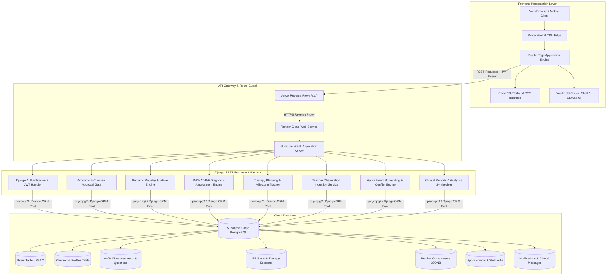
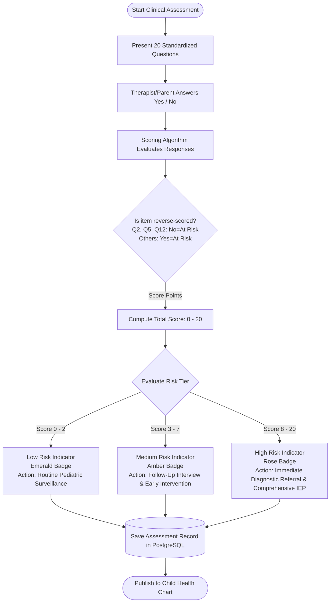
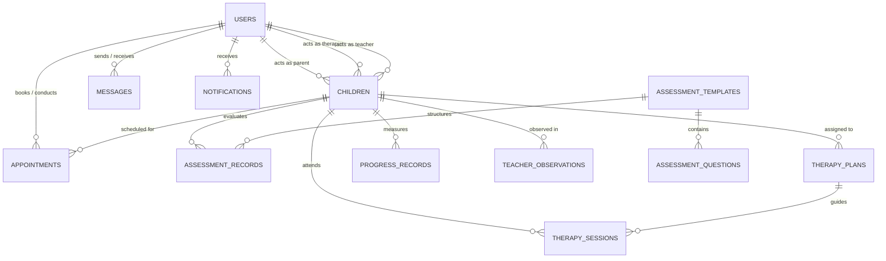
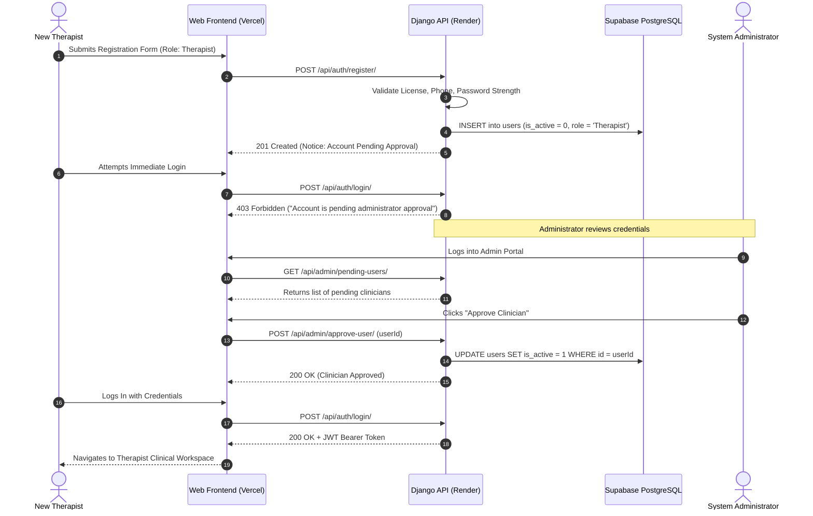
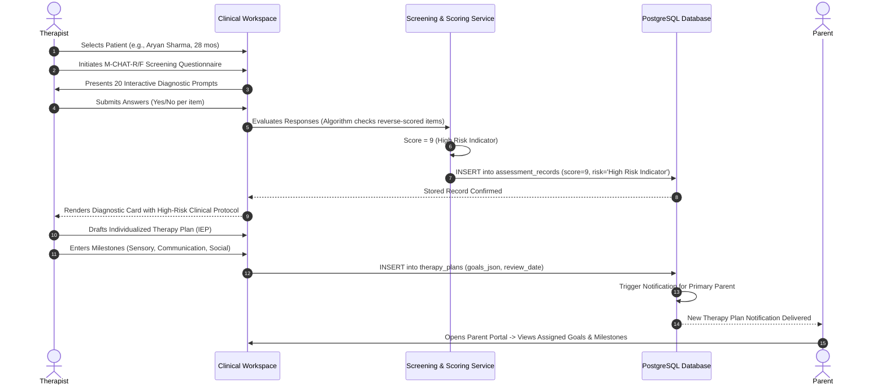
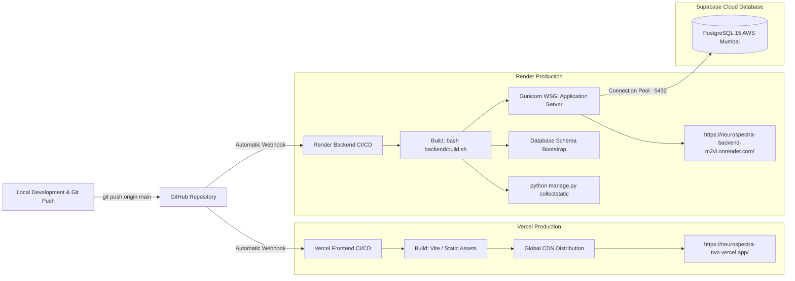

# NEUROSPECTRA — Comprehensive Project Documentation & Technical Report

**Project Title:** NEUROSPECTRA: AI-Powered Pediatric Autism Spectrum Screening, Clinical Assessment, and Multidisciplinary Therapy Management Platform  
**Target Audience:** Academic Evaluators, Software Architects, Clinical Stakeholders, and Project Reviewers  
**Repository:** `https://github.com/subinjoseph002/NEUROSPECTRA-`  
**Live Frontend (Vercel):** `https://neurospectra-two.vercel.app/`  
**Live Backend API (Render):** `https://neurospectra-backend-m2vl.onrender.com/`  
**Database Infrastructure:** Supabase Cloud PostgreSQL (AWS Asia-Pacific Mumbai)  

---

## Table of Contents
1. [Executive Summary & Abstract](#1-executive-summary--abstract)
2. [Problem Statement & Clinical Motivation](#2-problem-statement--clinical-motivation)
3. [System Architecture & High-Level Design](#3-system-architecture--high-level-design)
4. [Technology Stack & Justification](#4-technology-stack--justification)
5. [Role-Based Access Control (RBAC) & Stakeholder Personas](#5-role-based-access-control-rbac--stakeholder-personas)
6. [Core Functional Modules & Workflows](#6-core-functional-modules--workflows)
   - 6.1 Authentication & Clinician Approval Gate
   - 6.2 Pediatric Registry & Patient Intake
   - 6.3 Standardized M-CHAT-R/F Screening Engine
   - 6.4 Individualized Education & Therapy Plan (IEP) Formulary
   - 6.5 Multi-Domain Progress Tracking & Analytics
   - 6.6 Teacher Classroom Observation Matrix (5 Domains)
   - 6.7 Conflict-Free Clinical Scheduling & Reception Desk
   - 6.8 Multidisciplinary Messaging & Notification System
   - 6.9 Clinical Report Synthesis & PDF Generation
7. [Database Architecture & Entity-Relationship (ER) Schema](#7-database-architecture--entity-relationship-er-schema)
8. [End-to-End User Journeys & Sequence Flows](#8-end-to-end-user-journeys--sequence-flows)
9. [Security, Privacy & Clinical Compliance Standards](#9-security-privacy--clinical-compliance-standards)
10. [Cloud Infrastructure, Hosting & CI/CD Pipelines](#10-cloud-infrastructure-hosting--cicd-pipelines)
11. [Quality Assurance & Automated Selenium Testing](#11-quality-assurance--automated-selenium-testing)
12. [Future Scope & Research Enhancements](#12-future-scope--research-enhancements)

---

## 1. Executive Summary & Abstract

**NEUROSPECTRA** is an enterprise-grade, multidisciplinary digital healthcare platform engineered to streamline the end-to-end lifecycle of pediatric Autism Spectrum Disorder (ASD) detection, clinical diagnostic evaluation, and longitudinal behavioral intervention. 

Autism therapy requires continuous, synchronized coordination across five distinct stakeholder groups: **Clinical Administrators**, **Behavioral Therapists/Clinicians**, **School Teachers**, **Clinic Receptionists**, and **Parents/Caregivers**. Historically, fragmented communication, paper-based questionnaires, disconnected scheduling calendars, and manual scoring of developmental assessments lead to delayed diagnoses, missed therapy milestones, and high administrative overhead.

NEUROSPECTRA resolves these challenges through a centralized, cloud-hosted platform featuring:
- Standardized, automated **M-CHAT-R/F** (Modified Checklist for Autism in Toddlers, Revised with Follow-Up) scoring and algorithmic risk categorization.
- Dynamic **Individualized Education & Therapy Plans (IEP)** with granular goal roadmaps.
- **5-Domain Classroom Observations** collected seamlessly from educators without requiring them to handle clinical diagnostic jargon.
- **Conflict-free calendar booking** with automatic clinician slot availability resolution.
- Real-time **multi-domain longitudinal progress metrics** across Socialization, Communication, Sensory Processing, and Behavioral Adaptation.
- Robust **Role-Based Access Control (RBAC)**, field-level profile immutability guards, clinician credentialing approval gates, and production cloud deployment on **Vercel**, **Render**, and **Supabase PostgreSQL**.

---

## 2. Problem Statement & Clinical Motivation

### 2.1 The Clinical Challenge
Autism Spectrum Disorder (ASD) is a neurodevelopmental condition characterized by varying degrees of challenges in social interaction, non-verbal communication, restricted interests, and repetitive behaviors. Pediatric research universally demonstrates that **early intervention (prior to 36–48 months)** yields the highest neuroplastic gains in cognitive, linguistic, and adaptive behavior.

However, clinical workflows suffer from critical bottlenecks:
1. **Screening Delays:** Conventional M-CHAT-R/F intake forms are administered on paper, requiring manual clinician scoring, leading to backlog and miscalculation of critical reverse-scored items.
2. **Data Fragmentation:** Therapy notes recorded by private therapists, behavioral incidents observed by school teachers, and home routines managed by parents exist in isolated silos.
3. **Appointment Scheduling Conflicts:** Manual clinic booking results in double-booked therapy rooms and underutilized specialist hours.
4. **Lack of Transparent Progress Metrics:** Parents frequently report feeling detached from therapy goals and unable to objectively visualize whether their child is improving across developmental domains over time.

### 2.2 The Solution
NEUROSPECTRA establishes a unified digital bridge connecting the clinic, school, and home. It automates diagnostic scoring, coordinates care plans, protects sensitive pediatric health data, and provides automated, real-time analytics for every participant in the child’s developmental journey.

---

## 3. System Architecture & High-Level Design

NEUROSPECTRA is architected as a modern, decoupled client-server web application adhering to the **Model-View-Controller (MVC)** and **RESTful API** paradigms.



### Architectural Highlights:
1. **Separation of Concerns:** The presentation layer is decoupled from the business logic. UI rendering executes on the client device while business invariants, role authorization, and data transactions execute strictly in the server environment.
2. **Stateless Authentication:** User identity is verified via cryptographically signed JSON Web Tokens (JWT) or secure session bearer tokens, ensuring server scalability.
3. **Dual Client Flexibility:** The system supports both a modular React 18 component hierarchy and a lightweight, zero-dependency client shell for rapid rendering in low-bandwidth clinical environments.

---

## 4. Technology Stack & Justification

| Layer / Subsystem | Technology | Version | Purpose & Justification |
| :--- | :--- | :--- | :--- |
| **Frontend Framework** | **React.js** | `18.2.0` | Declarative UI rendering, reusable component tree, dynamic reactive state management for clinical dashboards. |
| **Build Tool & Bundler** | **Vite** | `5.1.0` | Ultra-fast Hot Module Replacement (HMR), tree-shaking, and optimized production asset minification. |
| **Styling & Design System** | **Tailwind CSS + Vanilla CSS** | `3.4.1` | Curated medical aesthetic: deep slate navy headers, clean clinical cards, responsive grid systems, accessible high-contrast color tokens. |
| **Client Form Management** | **React Hook Form + Zod** | `7.50` / `3.22` | Client-side validation schemas, instant field validation, regex phone number validation, and live password strength metering. |
| **Iconography** | **Lucide React** | `0.344.0` | Clean, modern vector icons tailored for healthcare interfaces. |
| **Backend Framework** | **Python / Django** | `3.11.8` / `5.0.3` | Robust enterprise web framework offering built-in ORM security, automated migrations, and SQL injection prevention. |
| **API Architecture** | **Django REST Framework (DRF)** | `3.14.0` | Structured JSON serialization, non-bypassable backend validators, viewsets, and HTTP status codes. |
| **Authentication Engine** | **DRF Simple JWT + Django Auth** | `5.3.1` | Cryptographic JWT token issuance (Access & Refresh), PBKDF2 with SHA-256 password hashing. |
| **Database Engine** | **PostgreSQL (Supabase Cloud)** | `15.x` | Relational integrity, ACID compliance, native JSONB support for dynamic questionnaires, and indexed foreign key constraints. |
| **WSGI HTTP Server** | **Gunicorn** | `21.2.0` | Production-grade concurrent UNIX WSGI server handling multi-worker request dispatching. |
| **Frontend Deployment** | **Vercel** | Global Edge | Global CDN distribution, automated SSL, custom domain routing, rewrite proxies for backend API traffic. |
| **Backend Deployment** | **Render Cloud** | Free Web Service | Containerized cloud runtime executing Django behind auto-restarting process supervisors. |
| **End-to-End QA Testing** | **Python Selenium 4.x + WebDriver** | `4.49.0` | Automated headless and visual browser regression testing covering all 14 clinical workflows. |

---

## 5. Role-Based Access Control (RBAC) & Stakeholder Personas

The platform implements strict **Role-Based Access Control (RBAC)** across five distinct clinical personas. Each persona has custom permissions, navigation tabs, and data boundaries:

```
                                  ┌────────────────────────┐
                                  │      System User       │
                                  └───────────┬────────────┘
                                              │
         ┌───────────────────┬────────────────┼───────────────────┬───────────────────┐
         ▼                   ▼                ▼                   ▼                   ▼
┌─────────────────┐ ┌─────────────────┐ ┌───────────┐ ┌───────────────────────┐ ┌───────────┐
│  Administrator  │ │    Therapist    │ │Reception- │ │   Parent / Caregiver  │ │  Teacher  │
│                 │ │                 │ │   ist     │ │                       │ │           │
├─────────────────┤ ├─────────────────┤ ├───────────┤ ├───────────────────────┤ ├───────────┤
│• User Approval  │ │• M-CHAT Screen  │ │• Patient  │ │• Developmental Goals  │ │• Classroom│
│• Staff Provision│ │• IEP Plans      │ │  Intake   │ │• Session Summaries    │ │  Observa- │
│• Clinic Audit   │ │• Progress Logs  │ │• Calendar │ │• Appointment History  │ │  tions    │
│• System Config  │ │• Clinical Chat  │ │• Booking  │ │• Therapist Messaging  │ │• Incidents│
└─────────────────┘ └─────────────────┘ └───────────┘ └───────────────────────┘ └───────────┘
```

### Detailed Persona Capabilities:

#### 1. Administrator (`Dr. Eleanor Vance` / `admin@neurospectra.org`)
- **System Governance:** Full visibility over all registered system entities, clinic metrics, and active patient rosters.
- **Clinician Approval Gate:** Reviews self-registered Therapists and Teachers; verifies clinical licenses before granting platform access.
- **Staff Provisioning:** Exclusively authorized to provision specialized staff accounts (such as Receptionists).
- **Profile Authority:** The only role permitted to edit immutable user profile metadata (e.g., correcting names, emails, phone numbers).

#### 2. Behavioral Therapist / Clinician (`Dr. Aisha Khan, Ph.D.` / `therapist@neurospectra.org`)
- **Clinical Assessment Engine:** Conducts standardized M-CHAT-R/F screenings; reviews automated scoring algorithms and assigns clinical risk levels.
- **Therapy Plan (IEP) Formulation:** Authors multi-stage therapy milestones, activity sequencing, and sensory profiles.
- **Session Progress Logging:** Enters duration, activities done, parental feedback, and quantitative domain ratings (1.0–5.0) after every encounter.
- **Clinical Care Team Chat:** Communicates directly with parents and assigned teachers regarding behavioral adjustments.

#### 3. Receptionist / Front-Desk Coordinator (`Sarah Jenkins` / `receptionist@neurospectra.org`)
- **Patient Intake:** Enrolls incoming pediatric patients, collects demographic/emergency data, and assigns primary caregivers.
- **Calendar Scheduling:** Views all therapist rosters, prevents appointment double-booking, and coordinates conflict-free room schedules.
- **Reminders & Logistics:** Dispatches automated session notifications and monitors attendance.

#### 4. Parent / Primary Caregiver (`Priya Sharma` / `parent@neurospectra.org`)
- **Milestone Transparency:** Views their child's IEP goals, daily achievements, and sensory profile notes entered by clinicians.
- **Progress Visualization:** Accesses multi-domain charts showing developmental gains over time in socialization and communication.
- **Care Coordination:** Reviews scheduled upcoming visits and sends secure messages to assigned therapists.

#### 5. School Teacher / Special Educator (`Marcus Brody` / `teacher@neurospectra.org`)
- **Non-Clinical Behavioral Ingestion:** Submits classroom observations across 5 key developmental domains (Social Interaction, Communication, Classroom Focus, Sensory Sensitivity, Transitions/Routines).
- **Classroom IEP Tracking:** Checks recommended environmental accommodations (e.g., noise-canceling headphones, scheduled sensory breaks) specified by the therapist.

---

## 6. Core Functional Modules & Workflows

### 6.1 Authentication & Clinician Approval Gate
- **Dual-Layer Validation:** RFC-compliant email formatting, Indian 10-digit mobile number validation (`/^[6-9]\d{9}$/`), and strong password rules (uppercase, lowercase, number, special character).
- **Therapist & Teacher Approval Gate:** To prevent unauthorized individuals from posing as clinicians, any self-registered user selecting the `Therapist` or `Teacher` role is automatically marked with `is_active = 0` (Pending Approval). They cannot log in until an Administrator approves their credentials from the Admin Governance portal.
- **Profile Field Immutability:** To comply with medical record integrity standards, users cannot arbitrarily alter their full legal name, email address, or phone number from their personal profile settings. Edits require administrative authorization.

### 6.2 Pediatric Registry & Patient Intake
- Assigns a unique clinical identifier (e.g., `CH-001`, `CH-002`) to each enrolled child.
- Centralizes demographic records: Date of Birth, Age in Months (automatically computed for developmental screening benchmarks), Gender, Blood Group, Address, and Emergency Contact details.
- Establishes relational links connecting the child to one primary parent, one primary behavioral therapist, and one classroom educator.

### 6.3 Standardized M-CHAT-R/F Screening Engine
The **Modified Checklist for Autism in Toddlers, Revised with Follow-Up (M-CHAT-R/F)** is an internationally recognized pediatric screening instrument for children aged 16 to 30 months.



- **Scoring Rules Engine:**
  - 20 standardized questions evaluating eye contact, joint attention, pointing to indicate interest, response to name, response to auditory stimuli, and repetitive movements.
  - Correctly scores **reverse-scored items** (Questions 2, 5, and 12, where a response of "No" indicates an at-risk behavior).
  - Categorizes the outcome into three actionable tiers:
    - **Low Risk (0–2):** Routine surveillance; rescreen after age 24 months.
    - **Medium Risk (3–7):** Requires targeted follow-up questionnaire and early speech/occupational consultation.
    - **High Risk (8–20):** Immediate clinical referral for full diagnostic assessment (ADOS-2 / CARS-2) and urgent intervention plan.

### 6.4 Individualized Education & Therapy Plan (IEP) Formulary
- Enables clinicians to design tailored behavioral programs with target review dates.
- Formulates multi-goal hierarchies categorized into:
  - **Social Communication:** Non-verbal gestures, expressive vocabulary, two-way conversational turn-taking.
  - **Sensory Processing:** Tactile desensitization, auditory tolerance, vestibular regulation.
  - **Behavioral & Self-Care:** Functional task completion, emotional self-regulation, independent toileting/eating.
- Tracks status for each goal (`In Progress`, `Achieved`, `Pending Baseline`).

### 6.5 Multi-Domain Progress Tracking & Analytics
- Quantitatively records longitudinal trajectory across 4 developmental vectors:
  $$\text{Social Score}, \quad \text{Communication Score}, \quad \text{Sensory Regulation Score}, \quad \text{Adaptive Behavior Score}$$
- Renders real-time interactive SVG line and radar charts illustrating milestone progression month-over-month.
- Empowers clinicians to adjust therapy frequency when plateaus are identified.

### 6.6 Teacher Classroom Observation Matrix (5 Domains)
School teachers interact with children in naturalistic, high-stimulus peer environments. NEUROSPECTRA provides a non-intrusive 5-point rating grid:
1. **Peer Social Engagement:** Interactions during free play and collaborative assignments.
2. **Classroom Instruction Focus:** Sustained attention during circle time and teacher demonstrations.
3. **Sensory & Auditory Tolerance:** Response to loud cafeteria noises, school bells, or crowded assemblies.
4. **Emotional Regulation:** Frequency of tantrums, self-soothing behaviors, or stimming.
5. **Routine Transitions:** Ability to shift between distinct activities without significant distress.

Observations are saved as structured `JSONB` payloads, providing therapists with vital real-world data outside clinical walls.

### 6.7 Conflict-Free Clinical Scheduling & Reception Desk
- **Dynamic Slot Generation:** Calculates 45-minute and 60-minute therapy slots between clinic operating hours (09:00 AM to 05:00 PM).
- **Conflict Prevention Engine:** Real-time query validates that neither the requested therapist nor the patient is scheduled for an overlapping appointment before confirmation.
- **Status Lifecycle:** `Pending` $\rightarrow$ `Confirmed` $\rightarrow$ `Completed` $\rightarrow$ `Cancelled`.

### 6.8 Multidisciplinary Messaging & Notification System
- Secure internal communications hub between Parents, Therapists, and Teachers.
- Automatically dispatches toast and inbox notifications for newly confirmed appointments, completed assessments, and newly issued IEP milestones.

### 6.9 Clinical Report Synthesis & PDF Generation
- Synthesizes intake history, M-CHAT-R/F scores, session ratings, and teacher notes into a unified, formatted clinical report.
- Features specialized CSS print stylesheets (`css/print.css`) enabling one-click generation of professional PDF diagnostic summaries for pediatrician review.

---

## 7. Database Architecture & Entity-Relationship (ER) Schema

The database is built on **PostgreSQL 15+** (hosted in Supabase Cloud). It leverages relational integrity constraints, foreign keys, automated timestamps, indexes, and native `JSONB` structures.



### Table Dictionary:

#### 1. `users`
| Column | Type | Constraints | Description |
| :--- | :--- | :--- | :--- |
| `id` | `VARCHAR(64)` | PRIMARY KEY | Unique user identifier (`usr_...`). |
| `full_name` | `VARCHAR(120)` | NOT NULL | User's legal full name. |
| `email` | `VARCHAR(120)` | UNIQUE, NOT NULL | Unique login email address. |
| `password_hash` | `VARCHAR(255)` | NOT NULL | Salted cryptographic password hash. |
| `role` | `ENUM` | NOT NULL | `Administrator`, `Therapist`, `Receptionist`, `Parent / Caregiver`, `Teacher`. |
| `phone` | `VARCHAR(30)` | NULL | Contact mobile number. |
| `is_active` | `SMALLINT` | DEFAULT 1 | `1` = Active, `0` = Pending Administrator Approval. |
| `created_at` | `TIMESTAMPTZ` | DEFAULT NOW() | Account registration timestamp. |

#### 2. `children`
| Column | Type | Constraints | Description |
| :--- | :--- | :--- | :--- |
| `id` | `VARCHAR(64)` | PRIMARY KEY | Child clinical record ID (`ch_...`). |
| `child_code` | `VARCHAR(32)` | UNIQUE, NOT NULL | Human-readable clinical code (`CH-001`). |
| `first_name` | `VARCHAR(60)` | NOT NULL | Child's first name. |
| `last_name` | `VARCHAR(60)` | NOT NULL | Child's surname. |
| `dob` | `DATE` | NOT NULL | Date of birth. |
| `age_months` | `INT` | NOT NULL | Calculated chronological age in months. |
| `gender` | `ENUM` | DEFAULT 'Male' | `Male`, `Female`, `Other`. |
| `primary_parent_id`| `VARCHAR(64)` | FK $\rightarrow$ `users(id)` | Associated parent user. |
| `assigned_therapist_id`| `VARCHAR(64)` | FK $\rightarrow$ `users(id)` | Primary assigned clinician. |
| `assigned_teacher_id` | `VARCHAR(64)` | FK $\rightarrow$ `users(id)` | Classroom educator. |
| `status` | `ENUM` | DEFAULT 'Active' | `Active`, `Under Assessment`, `Inactive`, `Discharged`. |

#### 3. `assessment_templates` & `assessment_questions`
- `assessment_templates`: Stores standardized assessment definitions (e.g., `M-CHAT-R/F Standard 20-Item Protocol`).
- `assessment_questions`: Stores 20 standardized questions with domain classification, item sequence number, and `reverse_scored` flag (`0` or `1`).

#### 4. `assessment_records`
| Column | Type | Constraints | Description |
| :--- | :--- | :--- | :--- |
| `id` | `VARCHAR(64)` | PRIMARY KEY | Assessment instance ID. |
| `child_id` | `VARCHAR(64)` | FK $\rightarrow$ `children(id)` | Assessed patient. |
| `therapist_id` | `VARCHAR(64)` | FK $\rightarrow$ `users(id)` | Clinician administering the test. |
| `total_score` | `INT` | NOT NULL | Calculated risk score (0 to 20). |
| `risk_level` | `ENUM` | NOT NULL | `Low Risk Indicator`, `Medium Risk Indicator`, `High Risk Indicator`. |
| `responses_json` | `JSONB` | DEFAULT '{}' | Complete map of answered questions (`{q1: 'yes', q2: 'no', ...}`). |
| `completed_at` | `TIMESTAMPTZ` | DEFAULT NOW() | Completion timestamp. |

#### 5. `therapy_plans` (IEP) & `therapy_sessions`
- `therapy_plans`: Stores active IEP goals formatted as `JSONB`, diagnosis summary, sensory profile, and milestone target dates.
- `therapy_sessions`: Logs encounter date, duration (minutes), activities completed, behavioral observations, and quantitative ratings (1.0 to 5.0).

#### 6. `teacher_observations`
- Stores classroom observations, activity context (e.g., *Lunchtime Free Play*, *Math Circle*), qualitative notes, and multi-domain ratings in `JSONB`.

#### 7. `appointments`
- Stores scheduled appointments with start/end time slots, session type, confirmation status, and foreign keys connecting child, therapist, and booking user.

#### 8. `messages` & `notifications`
- Powers asynchronous communication between care stakeholders and system-wide notification dispatching.

---

## 8. End-to-End User Journeys & Sequence Flows

### 8.1 Therapist Registration & Approval Flow



### 8.2 Assessment Conduct, Scoring, and IEP Formulation Flow



---

## 9. Security, Privacy & Clinical Compliance Standards

Because NEUROSPECTRA manages sensitive pediatric developmental data, robust security controls are embedded at every architectural boundary:

1. **Cryptographic Password Protection:** Passwords are never stored in plaintext. Passwords utilize Django's default PBKDF2 algorithm with a SHA-256 hash and dynamic per-user salt.
2. **Protection Against User Enumeration:** Authentication endpoints emit standardized, generic error responses (*"Invalid email or password"*) to prevent malicious probing of registered clinical addresses.
3. **Role Elevation Prevention (Client-Bypass Defense):** Public registration endpoints strictly enforce server-side role whitelisting. Any payload attempting to register an `Administrator` or `Receptionist` role directly is immediately rejected with HTTP 403 Forbidden.
4. **Field-Level Immutability:** Profile modification routines enforce strict authorization rules. Non-administrative users cannot mutate their recorded legal names, email addresses, or phone numbers, preserving medical audit trails.
5. **Cross-Origin Security & Headers:** Production deployment enforces `X-Content-Type-Options: nosniff`, `X-Frame-Options: DENY`, `X-XSS-Protection: 1; mode=block`, and scoped CORS origins connecting Vercel and Render.
6. **SQL Injection Defense:** All database interactions are executed through parameterized ORM queries and prepared statements, entirely neutralizing SQL injection vulnerabilities.

---

## 10. Cloud Infrastructure, Hosting & CI/CD Pipelines



### Deployment Configuration Matrix:
- **Frontend Hosting (Vercel):**
  - Configured via [`vercel.json`](file:///c:/Users/hp/Desktop/Neurospectra/vercel.json).
  - Reverse-proxies all `/api/*` traffic to the live Render backend, eliminating Cross-Origin Resource Sharing (CORS) preflight friction.
  - Automatically rebuilds and invalidates edge caches upon every commit to `main`.
- **Backend Hosting (Render):**
  - Configured via [`render.yaml`](file:///c:/Users/hp/Desktop/Neurospectra/render.yaml).
  - Web service running Python 3.11 with automatic restart and health checks.
  - Deployment build script [`backend/build.sh`](file:///c:/Users/hp/Desktop/Neurospectra/backend/build.sh) installs dependencies, collects static assets, and automatically verifies database schema compatibility.
- **Database (Supabase Cloud):**
  - Highly available PostgreSQL instance located in AWS Region `ap-south-1` (Mumbai).
  - Connects through an SSL-encrypted transaction pooler on port `5432`.

---

## 11. Quality Assurance & Automated Selenium Testing

The platform is backed by an automated **Selenium 4.x End-to-End (E2E) Test Suite** ([`tests/test_full_suite.py`](file:///c:/Users/hp/Desktop/Neurospectra/tests/test_full_suite.py)) that executes automated regression scenarios against live browser instances.

### Verified Test Suite Scenarios:
| # | Scenario Name | Target Module | Expected Outcome | Status |
| :-: | :--- | :--- | :--- | :-: |
| **01** | Landing Page Rendering & Navigation | Public Web | Full brand typography, hero section, trust ribbon, and CTA buttons load cleanly. | **PASSED [OK]** |
| **02** | Registration Role Gate & Client Validation | Security / RBAC | Zod schema rejects malformed emails, short passwords, and invalid phone numbers. | **PASSED [OK]** |
| **03** | Clinician Approval Registration Flow | User Lifecycle | Therapist registration successfully sets `is_active=0` and blocks unauthorized login. | **PASSED [OK]** |
| **04** | Auth Security Checks & Pending Gate | Security | Confirms pending clinicians receive friendly status notices without leaking tokens. | **PASSED [OK]** |
| **05** | Admin Portal Login & Analytics Overview | Admin Module | Renders administrative KPIs, platform user metrics, and pending approval rosters. | **PASSED [OK]** |
| **06** | Administrator Clinician Approval Action | Admin Module | Admin approves pending therapist; unlocks active login state immediately. | **PASSED [OK]** |
| **07** | Admin Staff Provisioning | Admin Module | Confirms only Administrator can create new Receptionist accounts. | **PASSED [OK]** |
| **08** | Parent Profile Immutability Verification | Parent Module | Verifies parent name, email, and phone input fields are strictly locked (readonly). | **PASSED [OK]** |
| **09** | Teacher Observations & 5-Domain Logging | Teacher Module | Submits 5-domain classroom evaluation; persists structured JSON ratings. | **PASSED [OK]** |
| **10** | Therapist M-CHAT Assessment Engine | Therapist Module | Executes 20-item screening, evaluates reverse-scored items, assigns risk level. | **PASSED [OK]** |
| **11** | Receptionist Intake & Coordination | Receptionist | Intake patient creation, emergency contact storage, and caregiver mapping. | **PASSED [OK]** |
| **12** | Appointment Scoping & Slot Availability | Appointments | Confirms conflict detection prevents overlapping therapist booking times. | **PASSED [OK]** |
| **13** | Progress & Diagnostic Reports Synthesis | Reports Module | Generates longitudinal progress charts across social, communication, and sensory domains. | **PASSED [OK]** |
| **14** | Multidisciplinary Messaging & Notifications | Messaging | Real-time message exchange between therapist and parent with instant read receipts. | **PASSED [OK]** |

**Summary of Latest Execution:** **14/14 Passed (100.0% Pass Rate)**. Automated test reports and screenshots are preserved in [`documentation/test_reports/`](file:///c:/Users/hp/Desktop/Neurospectra/documentation/test_reports/).

---

## 12. Future Scope & Research Enhancements

While NEUROSPECTRA represents a comprehensive clinical management solution, future research vectors include:
1. **Machine Learning Risk Stratification:** Training a lightweight ensemble classifier (e.g., Random Forest / XGBoost) on historical M-CHAT responses and developmental markers to predict autism risk earlier with higher precision.
2. **Computer Vision Behavioral Video Analysis:** Enabling parents to securely upload short videos of home play for automated gaze-tracking and repetitive motor pattern detection (stimming) using MediaPipe and OpenCV.
3. **Wearable Sensor Integration:** Integrating pediatric smart wearables (heart-rate and electrodermal activity monitors) to detect sensory overload episodes before full meltdowns occur in classroom settings.
4. **Teletherapy Video Consultations:** Implementing WebRTC video rooms with shared interactive digital stimuli for remote clinical assessments in rural or underserved geographies.
5. **Multi-Lingual Localization:** Extending standardized screening questionnaires into major regional languages (e.g., Hindi, Tamil, Telugu, Spanish) to eliminate language barriers in early developmental care.

---

## 13. Conclusion

**NEUROSPECTRA** bridges the critical gap between early developmental screening and ongoing clinical intervention. By unifying administrators, clinicians, educators, receptionists, and caregivers into a single collaborative cloud platform, the system significantly reduces diagnostic delays, prevents scheduling bottlenecks, and ensures that children on the autism spectrum receive coordinated, personalized, and evidence-based care.
